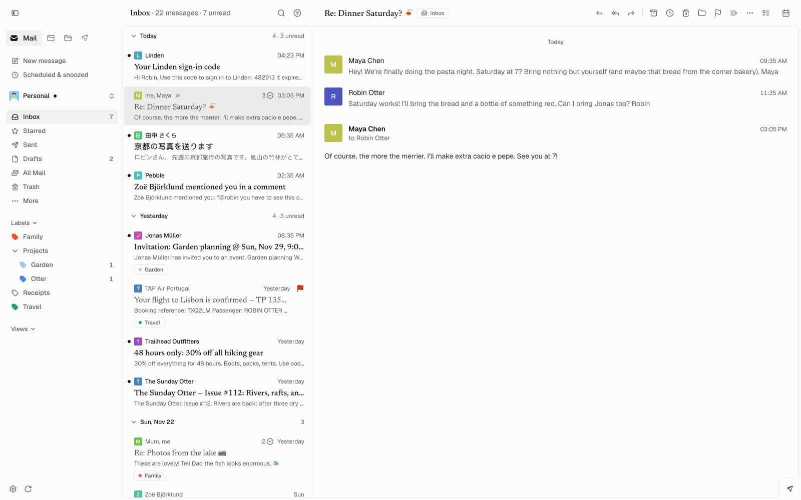

Margin is a new theme: ink on paper, Newsreader for subjects, quiet edges. Pick it in Settings › Appearance.

## New

- Margin changes more than color: its fonts, corners and overlays are its own.
- Vermilion marks today in Calendar and a chat waiting for your answer.

## Improved

- ⌘E opens the agent, ⇧⌘E its workspace, and ⌘D settles the chat.
- ⌥1–9 switch modes, in the switcher's order; the calendar panel moves to ⇧⌘C.
- Hover is instant on rows, chips and the sidebar.

## Fixed

- Setup asks you to sign in before adding an agent, instead of failing.
